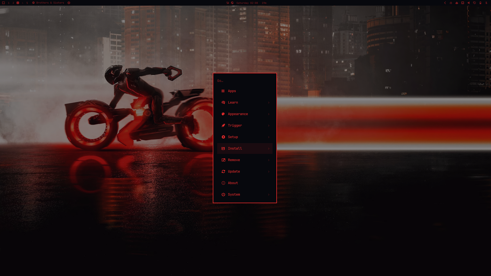
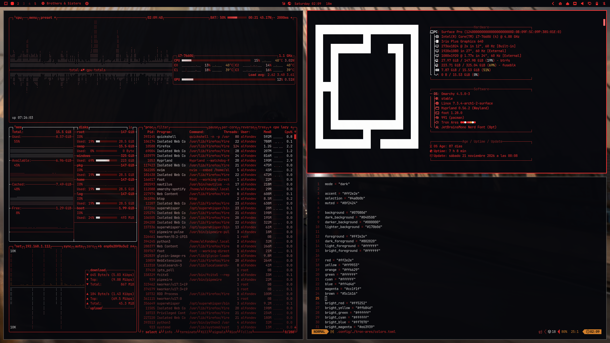

<div align="center">

# TRON: ARES — OMARCHY THEME

**High-contrast neon red & pure white theme for Omarchy, inspired by *Tron: Ares* and Dillinger Systems terminals.**


</div>

---

## Preview

### Desktop & Launcher


| Tiling & Terminal (`btop` / `fastfetch`) | Clean Workspace |
| :---: | :---: |
|  |  |

---

## Installation

Install directly using Omarchy's built-in theme manager:

```bash
omarchy-theme-install https://github.com/AlfonDev/omarchy-tron-ares-theme
```

Once installed, apply the theme from the Omarchy menu (**`Super + Alt + Space`** → *Style* → *Theme* → **`tron-ares`**) or via terminal:

```bash
omarchy-theme-set tron-ares
```

---

## Color Palette

Designed for maximum readability and low eye strain on dark displays, pairing deep obsidian backgrounds with razor-sharp neon red and crisp white highlights.

| Role | Hex | Preview |
| :--- | :--- | :---: |
| **Background (Obsidian)** | `#07080d` |  |
| **Foreground / Borders (Neon Red)** | `#ff2e2e` |  |
| **Highlights / Commands (Pure White)** | `#ffffff` |  |
| **Warnings / Dates (Amber)** | `#ff9933` |  |
| **Selection Fill** | `#4a0b0b` |  |

---

## Recommended Icon Theme (Optional)

This theme is pre-configured to use **Sweet-Red** folder icons (`icons.theme`). To get the matching black-and-neon-red folders on Arch/Omarchy, install them from the AUR:

```bash
yay -S sweet-folders-icons-git
```

---

## Included Wallpapers

Comes bundled with **5 high-resolution *Tron: Ares* wallpapers** inside `backgrounds/`. Cycle through them anytime using **`Super + Ctrl + Space`**.

---

<div align="center">
  <sub>Created by <a href="https://github.com/AlfonDev">AlfonDev</a> for the Omarchy community.</sub>
</div>
